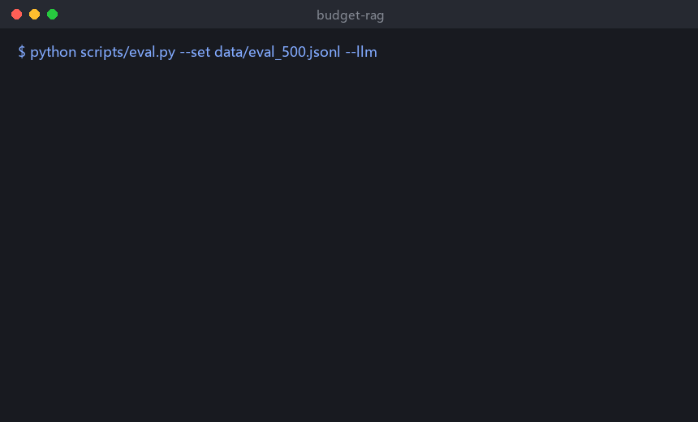
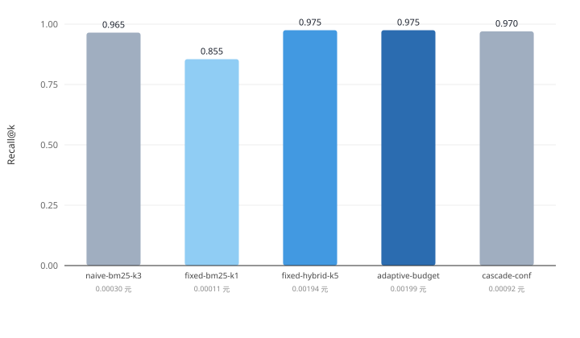
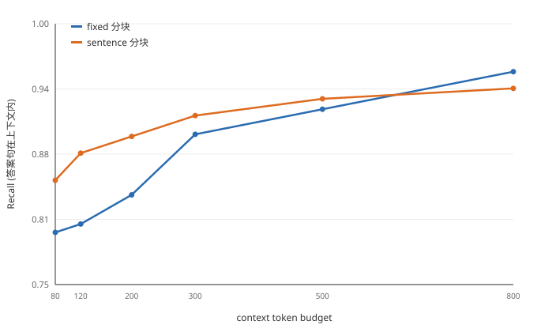
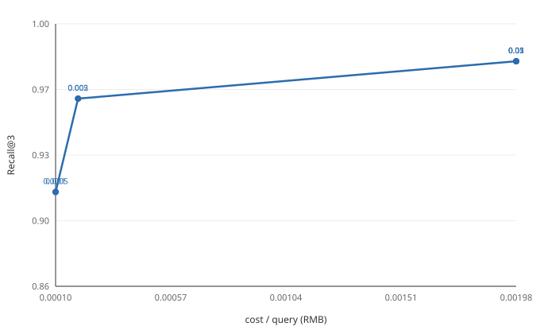

# budget-rag

> 成本感知的长文档问答检索：简单问题走便宜路径，难题才升级重排与大模型。



## 主要结果

200 条评测、同一预算口径下（检索召回 = 答案片段是否被召回）：

| 策略 | 召回 | 95% CI | 平均 token |
|---|---|---|---|
| BM25 | 0.825 | [0.770,0.875] | 68 |
| 纯向量 | 0.910 | [0.870,0.945] | 115 |
| 混合 | 0.900 | [0.860,0.940] | 114 |
| Adaptive-RAG 近似 | 0.855 | [0.805,0.905] | 100 |
| CRAG 近似 | 0.925 | [0.885,0.960] | 179 |
| **本方法** | **0.960** | [0.930,0.985] | **126** |

对全部 5 个基线显著（配对 bootstrap + McNemar，p<0.05）；5 次子采样的
本方法区间 `[0.947,0.970]` 与 CRAG `[0.925,0.932]` 不重叠。

**多跳生成基准**（本地 Qwen3-4B，800 token 预算）：

| 数据集 | 有检索 | 不检索 |
|---|---|---|
| HotpotQA | 0.400 | 0.100 |
| 2WikiMultiHopQA | 0.200 | 0.000 |
| MuSiQue | 0.250 | 0.000 |

论文草稿：[docs/paper-draft.md](docs/paper-draft.md)（Word 版 `docs/paper-draft.docx`）。
完整实验记录：[docs/report.md](docs/report.md)。复现：`make check`。

## 为什么做

长文档 RAG 的账单大头不是回答，是**检索冗余**：每次都召回 top-k、每次都用最强模型。
这个项目把「检索深度」和「模型档位」都变成**可预算的旋钮**，并给出一条
`召回率 ↑ / 每 query 成本 ↓` 的权衡曲线。

## 架构

```
 question
    │
    ├─ 查询分析 (长度/词稀有度/是否含实体)
    │
    ├─ 路由器 ── cheap ──> BM25 top-k ─┐
    │            └ strong ─> hybrid + rerank ─┤
    │                                        │
    ├─ 检索结果 + 打分 ─────────────────────┤
    │                                        ▼
    └─ 答案生成：offline(抽取) / LLM(可选) ──> answer + trace
```

每次查询都会输出 `trace`：走了哪条路、召回了几块、花了多少钱、耗时多少。

## 快速开始

```bash
# 1. 环境（Python 3.10+，默认零第三方依赖即可跑通离线模式）
python -m venv .venv && .venv\Scripts\activate     # Windows
# source .venv/bin/activate                       # Linux/macOS

# 2. 建索引
python scripts/ingest.py --docs data/sample_docs

# 3. 跑评测（离线，不花钱）
python scripts/eval.py --set data/eval_set.jsonl --k 3

# 4. 起服务（需要 fastapi/uvicorn）
pip install -r requirements.txt
uvicorn budget_rag.api:app --app-dir src --reload
```

接真实模型（可选）：

```bash
set DEEPSEEK_API_KEY=sk-xxx          # Windows
export DEEPSEEK_API_KEY=sk-xxx       # Linux/macOS
python scripts/eval.py --set data/eval_set.jsonl --llm
```

## 策略对比



改写问句集（200 条，问句不照抄原文用词）上的表现：

| 策略 | Recall@3 (95% CI) | cost/query |
|---|---|---|
| `naive-bm25-k3` | 0.965 [0.935, 0.990] | 0.000295 元 |
| `fixed-hybrid-k5` | 0.975 [0.955, 0.995] | 0.001942 元 |
| `cascade-conf` | 0.970 [0.945, 0.990] | 0.000917 元 |

级联策略用 **47% 的成本**拿到深检索 99.5% 的召回。完整实验见 [docs/report.md](docs/report.md)，
其中也写了一个负结果：合成集上各策略差异落在置信区间内，必须换真实数据集才能下结论。

复现：`python scripts/bench.py --set data/eval_hard.jsonl`

## 分块粒度（同预算对比）



固定 320 字块 vs 每句一块，在**相同 token 预算**下比较（`python scripts/chunk_budget.py`）：

| 预算 | fixed | sentence |
|---|---|---|
| 80 tok | 0.800 | **0.850** |
| 200 tok | 0.836 | **0.892** |
| 300 tok | 0.894 | **0.912** |
| 800 tok | **0.954** | 0.938 |

预算 ≤500 token 时句级切块更好，且预算压得住（要 80 只花 90，固定块会花到 192）。
超过 800 后固定块反超。

### 双索引自动选择（默认）

`chunk_mode=auto` 时同时建两套索引，按上下文预算自动选：

| 上下文预算 | 用的索引 | Recall | cost/query |
|---|---|---|---|
| 100 tok | sentence | 0.850 | 0.00025 元 |
| 300 tok | sentence | 0.900 | 0.00065 元 |
| 800 tok | fixed | 0.944 | 0.00181 元 |

调预算：`RAG_CTX_TOKENS=300`；调切换点：`RAG_AUTO_THRESHOLD=500`。

## 缓存

两层缓存，默认开启：

| 层 | 存什么 | 位置 | 开关 |
|---|---|---|---|
| 答案 / 改写 | LLM 返回文本 | `.cache/llm.json` | `RAG_CACHE=0` 关 |
| 向量 | embedding 结果（float32 BLOB） | `.cache/embed.db` | `RAG_EMBED_CACHE=0` 关 |

向量之所以用 SQLite 而不是 JSON：一条 1024 维向量 JSON 要 8KB，BLOB 只要 4KB，
而且能按 key 精确读、不必整文件进内存。

实测（LongBench 30 条，bge-m3）：冷缓存 46.6 秒 → 热缓存 **4.6 秒**，重复跑零 API 成本。

```bash
python scripts/cache_stats.py   # 看条目数、命中率、占用
```

## 接真实 embedding

默认的 `HashEmbedder` 是**离线占位**（零依赖，保证克隆下来就能跑）。换成真实模型只要三个环境变量：

```bash
export RAG_EMBED_BASE=https://api.siliconflow.cn/v1
export RAG_EMBED_MODEL=BAAI/bge-m3
export RAG_EMBED_KEY=sk-xxx
```

任何 OpenAI 兼容的 `/embeddings` 接口都能接（SiliconFlow、通义、本地 vLLM 都行）。
没配 key 时自动退回哈希实现，不会报错。

**已实测（500 条，300 token 预算）：**

| 检索方式 | Recall |
|---|---|
| BM25 | 0.892 |
| 哈希向量 | 0.884 |
| **bge-m3 纯向量** | **0.938** |
| 混合（alpha=0.1，调优后） | **0.946** |

混合权重默认 `alpha=0.1` 是扫出来的（0.5 只有 0.924）。
注意：该值只在本语料验证过，换数据集要重扫。

```bash
python scripts/embed_compare.py   # 哈希 vs 真向量
python scripts/tune_alpha.py      # 扫混合权重
```

## 数据

- `data/sample_docs/`：3 篇示例文档，拿来跑通流程
- `data/eval_set.jsonl`：每行 `{"question": ..., "answers": [...], "doc": ...}`
- 想扩到真实数据，换掉这两处即可，代码不用改

## 评测指标

| 指标 | 含义 |
|---|---|
| Recall@k | 命中答案所在块的比例 |
| EM / F1 | 答案与标注的精确/词级重合 |
| cost/q | 每 query 估算成本（元） |
| p95 latency | 95 分位延迟（ms） |

## 预算–效果权衡



| 档位 | budget | Recall@3 | cost/query |
|---|---|---|---|
| 紧预算（k=1, BM25） | 0.0005 – 0.001 | 0.9109 | 0.000105 元 |
| 常规（k=2, BM25） | 0.002 – 0.005 | 0.9604 | 0.000196 元 |
| 宽裕（k=5, 混合检索） | 0.010 – 0.050 | 0.9802 | 0.001976 元 |

从中间档升到宽裕档，Recall 只涨 **2 个百分点**，成本却涨 **10 倍**——
所以默认预算放在常规档，难题再单独加码。

复现：`python scripts/sweep.py --set data/eval_set.jsonl`

## 目录

```
src/budget_rag/    核心库（离线可跑，零依赖）
scripts/           ingest / eval
data/              样例文档与评测集
tests/             unittest，标准库即可
docs/              架构与实验记录
```

## 路线图

已完成：

- [x] 双索引（句级 / 固定块）+ token 预算取块
- [x] 混合检索（BM25 + 向量），权重扫描（alpha=0.1）
- [x] 真实 embedding 接入（bge-m3，已验证）
- [x] 评测集扩到 500 条（含改写题）
- [x] 查询改写 + 置信度门控
- [x] 人工标注校准 + 双人 kappa
- [x] Docker 一键起、CI、27 个测试

下一步：

- [ ] 换公开数据集（LongBench / NQ）验证外部效度
- [ ] 多 seed 方差报告
- [ ] API 鉴权与限流

## License

MIT
