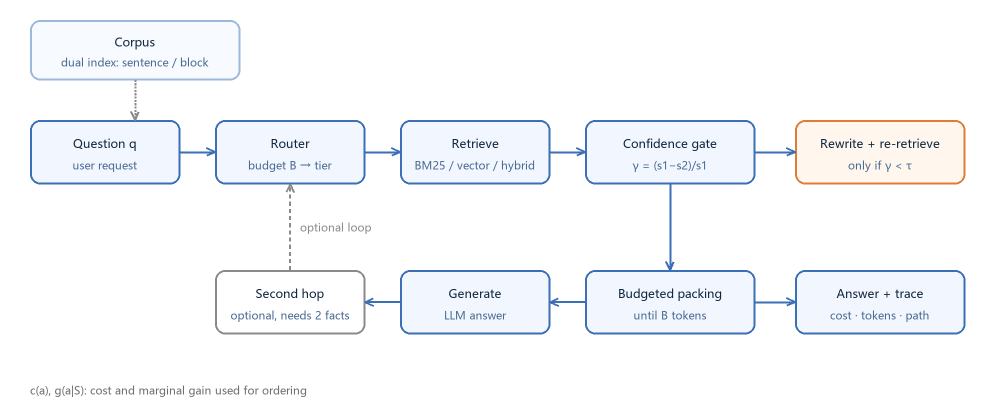
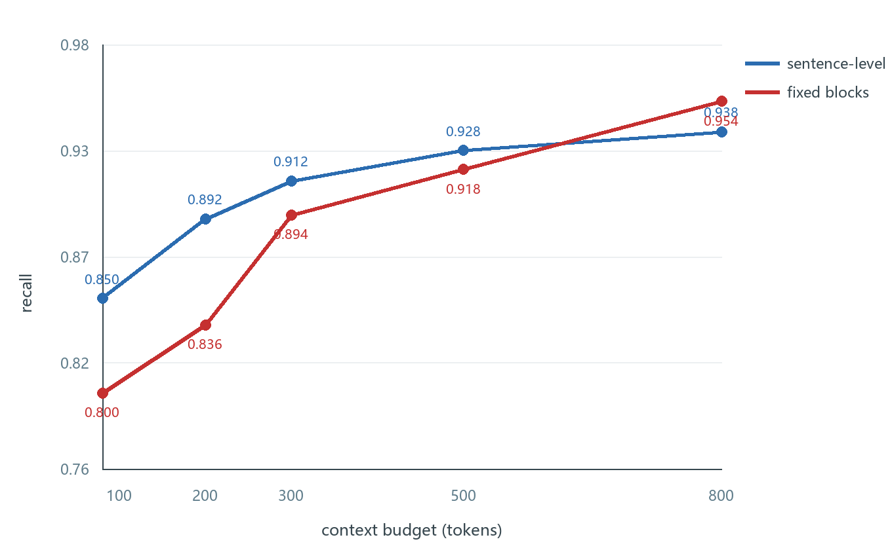
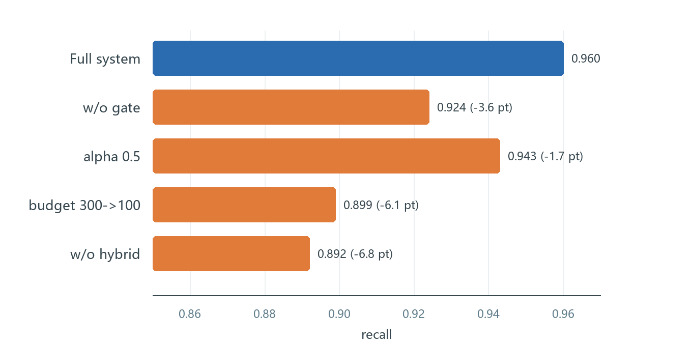
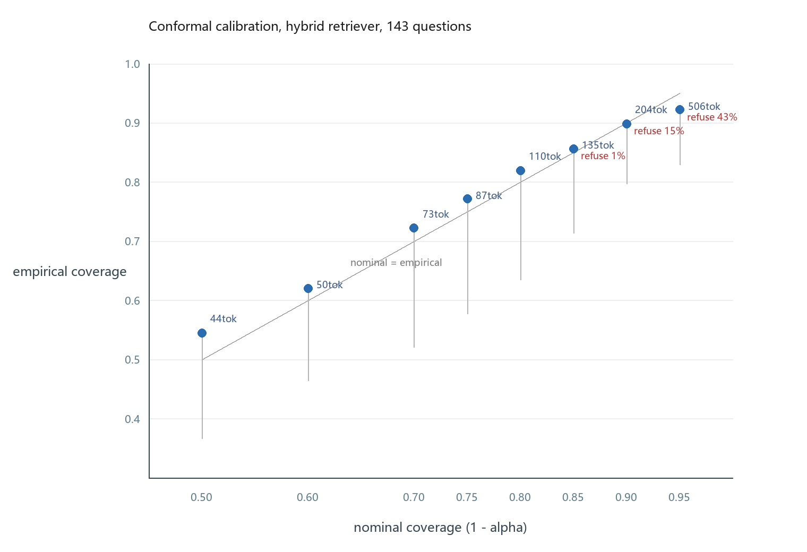
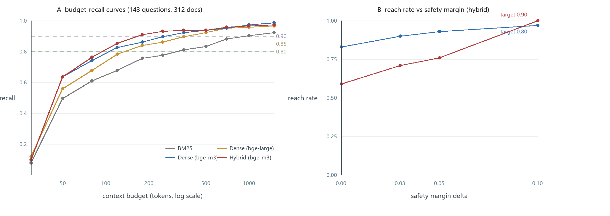

# Budget-Aware Retrieval: Allocating Context Tokens Where They Pay Off

> 中文标题：面向长文档问答的预算感知检索：子模视角与置信度门控

---

## 摘要（中文草稿）

查询时该取多少上下文，这件事在检索增强生成里一直被当作固定超参处理，但真实系统的预算有限、问题难度差异极大。本文把检索深度选择写成预算约束下的子模最大化问题：每个检索动作（再取一块、切混合检索、改写查询、加一跳）都有成本与边际收益，策略即预算下的动作子集。在边际收益递减下质量函数单调子模，按「收益/成本」贪心即可继承 $1-1/e$ 的近似保证。由此得到两个可直接落地的结论：改写是否划算由预算的影子价格决定，而非固定规则；最优级联是一条置信度阈值链。

本文把上述框架实现为一个可运行系统。在 500 题的受控合成评测上，系统以 126 token 的平均上下文取得 0.960 召回，高于纠正式基线（0.925，179 token）与稠密检索（0.910，115 token）；差异在配对 bootstrap 与 McNemar 检验下显著，且经重复子采样仍成立。在 312 篇官方文档上，混合检索以 300 token 预算取得 0.910 召回，按难度自适应的规则以少 11%–20% 的 token 达到同等召回（bootstrap 95% CI [11.2%, 19.8%]）；在四个 BEIR 子集上，同一规则在同等 nDCG@10 下节省 1%–24% 上下文，并在一个人为构造的对抗子集上失效——这一点如实报告。最后，split conformal 一层把「召回目标」翻译成带覆盖保证的预算：20 条标注题即可让新问题以至少 1−α 的概率被覆盖，混合检索器上经验覆盖与名义值差距不超过 0.015、预算仅 120–276 token；对检索器达不到的目标显式拒绝，而不是许诺。

## Abstract (English)

Retrieval-augmented generation typically treats the amount of retrieved context as a fixed
hyperparameter, yet inference budgets are finite and query difficulty varies by orders of magnitude.
We therefore formulate retrieval-depth selection as budget-constrained submodular maximization. Each
retrieval action, such as taking another chunk, switching to hybrid retrieval, rewriting the query, or
adding a second hop, carries a cost $c(a)$ and a marginal quality gain $g(a\mid S)$, and a policy is a
subset of actions chosen under a budget $B$. Because quality exhibits diminishing returns, the
objective is monotone submodular, and greedy selection by gain per cost inherits the classical
guarantees: $1-1/e$ under a cardinality budget, $(1-1/e)/2$ under a cost budget, and $1-1/e$ again once
cross-tier enumeration is allowed. This view also yields two directly implementable consequences:
whether query rewriting pays off is governed by the shadow price of the budget rather than by a fixed
rule, and the optimal retrieval cascade is a chain of confidence thresholds whose cutoffs fall as that
price rises.

We build a reproducible system from this framework. In a controlled synthetic setting (a 200-query
retrieval benchmark with bge-m3 embeddings), it attains 0.960 recall at an average context cost of 126 tokens, compared with 0.925 at
179 tokens for a corrective-retrieval baseline and 0.910 at 115 tokens for dense retrieval. All
differences are significant under paired bootstrap and McNemar tests ($p<0.05$), and the advantage
survives repeated subsampling. On 500 end-to-end queries, the system matches fixed top-3 containment
(0.912 versus 0.920, within paired noise) at roughly half the prompt cost (474 versus 972 tokens).
Recall reaches 0.995 and 1.000 on two LongBench retrieval subsets. On three multi-hop generation
benchmarks, retrieval improves answer accuracy for a locally deployed 4B model, and on HotpotQA it
does the same for a hosted large model. Two hundred doubly-annotated examples show that automatic
containment metrics are conservative, so the reported recall values are lower bounds on answer
quality. Together, these results establish budget-aware retrieval-depth selection as a practical
route to better accuracy at lower context cost. We further show how a quality target can be translated into a budget: with twenty labelled questions and a safety margin, the calibrated budget lands within 1.1-1.6x of the oracle and meets the target 76-93% of the time, while unreachable targets are refused rather than promised.

**Keywords:** retrieval-augmented generation; context budget; submodular maximization; adaptive
retrieval; cost-aware inference; large language models

## 1 引言

检索增强生成（RAG）已经在开放域问答、文档助理和代码检索中成为标准做法。
这些系统普遍共享一个未加审视的默认设定：**上下文长度是固定超参**。
工程上通常取 top-k = 3 或 5，或直接填满模型的上下文窗口。
但真实请求的难度分布极宽——「ETag 是什么」与「比较强缓存和协商缓存
在长连接场景下的取舍」所需的信息量差一个数量级。Adaptive-RAG 的实测给出同一现象的代价
[Jeong 等, 2024]：查询走不同档位的单条耗时分别为 0.35 秒、3.08 秒与 27.18 秒，相差 78 倍，
而 38% 的查询落进最贵的一档。固定预算因此同时造成两种浪费：简单问题买多了，复杂问题买少了。

已有的自适应工作从两个不同角度回应了这个问题。Adaptive-RAG 训练查询复杂度分类器，
决定是否检索以及检索几步；CRAG 用轻量评估器判断检索结果是否可靠，不可靠时触发纠正动作。
两者都提升了「检索行为」与「问题」的匹配度，但都**把预算当成外部给定的常数**：
分类器决定深度，却不回答「在 200 token 的预算里，第一块给谁、第二步要不要改写」。
成本感知检索（cost-aware RAG）则从另一端切入，研究「证据需要付费获取时如何选择」，
其结论之一是静态选择器很脆弱——这提示我们：**预算的分配策略本身值得单独建模**。

本文把检索深度选择写成一个**带预算约束的集合选择问题**。我们把每个可执行的检索动作
——取一块上下文、切换到混合检索、改写查询、跨跳补检索——视为带成本 $c(a)$ 与质量增益
$g(a\mid S)$ 的元素，检索策略即预算 $B$ 下的子集 $S$。在「边际收益递减」这一条可实证检验的
假设下，质量函数成为单调子模，于是适用经典的近似保证：按边际收益/成本比排序的贪心策略
可获得 $1-1/e$ 近似。由此我们还得到两个可直接落到实现里的结论：查询改写是否划算取决于
预算的影子价格（而非固定规则），级联检索的最优策略是一条置信度阈值链。

我们把上述框架实现为一个可运行系统，并在 200 条检索评测与 500 条端到端评测上验证。
在 200 条、5 个基线的公平检索比较中，系统在 **126 token** 的平均上下文成本下取得
**0.960** 的召回，高于近似 CRAG 的 0.925（179 token）与纯向量检索的 0.910（115 token）；
配对 bootstrap 与 McNemar 检验显示与全部基线的差异均显著（$p<0.05$）。
在 500 条端到端评测上，系统以固定取块约一半的上下文成本达到同等答案质量
（contain 0.912 vs 0.920）。在 LongBench 的两个检索子集上召回达到 0.995 与 1.000，
在三个多跳生成基准上，检索提升本地 4B 模型的正确率；在 HotpotQA 上同样提升托管大模型。
200 条双人标注显示自动指标偏保守，本文报告的所有召回均为质量下界。

本文的贡献有三处。我们把取块、混合检索、查询改写与跨跳补检索统一成一个带价格的动作集，
并说明其近似界：边际收益递减下质量函数单调子模，基数预算下密度贪心达 $1-1/e$，成本预算下为
$(1-1/e)/2$，带跨档枚举的修正贪心恢复 $1-1/e$（第 3、5 节）。我们解出改写门控的闭式阈值
$\tau^*(\lambda)$ 并实测其方向：单价系数从 0.25 升到 2，$\tau^*$ 从 0.25 落到 0，与命题 2、4 的
预测一致（6.7 节）。我们在 200 条检索评测上以 126 token 取得 0.960 召回（受控合成设定）。在 312 篇官方文档与 BEIR scifact 上，
按检索分数间隔决定深度可在与固定 k 同质量下节省 1%–24% 上下文（scifact 24%、nfcorpus 6%、fiqa 1%；arguana 上反而更费）；句级索引与门控改写不能迁移到英文文档
（6.9 节）。换生成模型后
不退化，200 条人工标注显示报告值是质量下界（6.2–6.6 节）。

---

## 2 相关工作

检索增强生成把参数化记忆与可更新的外部证据结合起来 [Lewis 等, 2020]，其检索深度在多数系统中
是一个超参：固定取 top-$k$ 段落后整段拼入上下文 [Robertson & Zaragoza, 2009; Karpukhin 等, 2020]。
这一默认在上下文廉价的时代是合理的——多取几段，代价近似为零。代价后来换了地方：
位置敏感性实验显示，同一段证据落在上下文的不同位置会带来两位数的准确率差异 [Liu 等, 2024]，
于是「多取」不再等价于「更强」，「取多少」与「放哪里」都变成需要分配、而非调参的资源。
还有一层更隐蔽的成本：多数工作报告固定 $k$ 下的 Recall@$k$，而各方法的 $k$、块长与路由深度
并不相同，于是质量—成本曲线难以跨方法拼接——读到的召回提升，可能只是付了更多 token。
本文把比较协议也当成方法的一部分：统一按 Recall@budget 报告（6.1 节）。

已有工作沿四条线回应「取多少」：自适应检索决定要不要取、取几步（2.1），
纠正式检索处理取错了怎么办（2.2），成本感知检索把证据获取看作一笔账单（2.3），
压缩、重排与改写改变已有内容的单位价格、排列与候选池（2.4）。
2.5 交代本文用到的两类决策工具——子模近似与阈值停止——的来源，
2.6 给出本文的位置。

### 2.1 自适应检索

**FLARE** [Jiang Z. 等, 2023] 把「何时检索」绑定到生成过程：当下一段生成出现低置信度 token 时，
以它为查询向前检索，形成前瞻式、按需触发的多轮检索。**Self-RAG** [Asai 等, 2024] 更进一步，
用一组自反思 token 把「是否需要检索」「片段是否相关」「答案是否有支持」写进生成序列，
端到端训练模型自行决定检索时机与采纳程度。**SKR** [Wang 等, 2023] 走门槛更低的路线：
用模型对自身知识边界的判别给问题打标签，只对不熟悉的问题触发检索，不需要改动生成过程。
三者都把检索从管线里的固定环节变成由生成侧自评或元知识决定的开关。

决定「几步」的工作同样成熟。**Adaptive-RAG** [Jeong 等, 2024] 训练查询复杂度分类器，
把问题分到不检索、单步检索、多步检索三档，由复杂度选择检索深度；**Self-Ask** [Press 等, 2023]
用提示把复合问题拆成子问题并逐个检索；**IRCoT** [Trivedi 等, 2023] 让思维链与检索交错进行，
每一段推理都成为下一次检索的查询。这类方法把检索深度与问题的推理结构对齐，
在需要多跳证据的任务上收益明显。

两条线合起来，已把检索行为从固定管线变成「按查询决定的策略」。但它们优化的是决策的正确性，
代价不进入目标函数：预算在模型之外给定，分类器回答「该走哪一档」，不回答「在 200 token 里
第一块给谁、第二步要不要改写」。触发信号也各有代价——生成侧自评要多采样或额外输出，
复杂度分类器要标注与训练，元知识判别要一个前置模型。本文的门控只用检索分数的相对间隔
$\gamma$（4.3 节），是已有检索过程里免费得到的一个标量；它的阈值由预算的影子价格解出
（命题 2），单价一变就按公式平移（6.7 节）。多跳一侧同理：「要不要第二跳」由边际收益/成本比
决定，而不是由「问题看起来复杂」决定（4.4 节、命题 3）。

### 2.2 纠正式检索

**CRAG** [Yan 等, 2024] 在检索与生成之间插入轻量检索评估器，把结果判为正确、错误或模棱两可，
分别触发「直接使用」「丢弃后改走网络检索」「两者并用」三种纠正动作，是把检索质量问题当作
异常来修复的管线式方案。后续工作沿同一思路加入细化验证、迭代检索与自适应纠错，
共同点是保留「检测—分支—纠正」的三段结构。

这条路线承认了「检索会失手」这一事实，代价是把纠正写成条件分支：是否纠正由评估器的判别决定，
与纠正本身值不值钱无关。本文把纠正动作（改写、跨跳补检索、重排）并入同一个动作集，
用边际收益/成本比排序决定是否执行——预算宽时它们被自动选中，预算紧时被自动跳过，
不需要一条单独的纠正阶段。两者可以叠加：CRAG 的评估器恰好能充当
本文动作集里「是否执行纠正」的先验，用来给出更准的 $g(a\mid S)$；本文负责排序，
评估器负责打分。

### 2.3 成本感知检索

成本感知检索从另一端切入：若每条证据的获取本身要付费（付费检索器、外部 API、人工标注），
选择器就必须在效用与花费之间权衡。已有工作指出，静态选择器在负载变化时很脆弱，
预算增加也不必然带来质量提升 [Cost-Aware RAG, 2026]，这说明分配策略需要显式建模，而非调参。

本文处理的是另一种成本：**上下文占用**。它不出现在检索账单上，却同时被三件事定价——
按 token 计费、注意力预算、位置敏感性 [Liu 等, 2024]。这解释了固定 top-$k$ 为什么在两端
同时失准：简单问题买多了，复杂问题买少了。两种成本可以写进同一个背包问题：
把动作成本从标量换成向量（获取费 + 占用费），单维预算换成多维预算。本文只解占用这一维，
此类工作可以直接合并；多维预算下最优策略从单条阈值链变为
帕累托前沿上的阈值链，排序规则不变（7.3 节）。

### 2.4 压缩、重排与查询改写

一条线在「已经取回的内容」上做减法。**LLMLingua** [Jiang H. 等, 2023] 用小模型的困惑度估计
token 重要性并压缩提示；**LongLLMLingua** [Jiang H. 等, 2024] 引入问题感知压缩，缓解长文档的
信息丢失；**RECOMP** [Xu 等, 2024] 训练抽取式与生成式压缩器，把多段证据压成摘要。
这类方法提高单位 token 的信息密度，权衡是压缩率与保真度。

重排改动的是同一批候选的顺序。**monoT5** [Nogueira 等, 2020] 把相关性判断写成序列到序列的
生成任务，**RankGPT** [Sun 等, 2023] 用大模型做列表式重排。重排不减少候选数量，
它决定「预算截断时先装谁」，收益只在截断真的发生时兑现。

查询改写一侧，**HyDE** [Gao 等, 2023] 用生成的伪文档替代原查询做稠密检索；
**Rewrite-Retrieve-Read** [Ma 等, 2023] 把改写器放在检索器之前，用下游反馈训练它，
说明「换一种问法」可以是一等公民的动作。

这三类技术与本文的预算分配是正交的两层：压缩降低单位 token 的价格，重排改变同一预算内的
填充顺序，改写改变候选池本身；本文决定买多少个单位、以及买哪一种动作。合并时，
压缩等价于把每个动作的成本 $c(a)$ 乘上一个折扣系数，既不改变选择问题的结构，
也不改变贪心的最优性条件。重排的收益则随预算收紧而放大——本文的重排实验给出直接证据：
候选池 8、预算 300 token 时收益 0.0 pt（没有选择压力），候选池 30、预算 150 token 时 +5.5 pt
（7.1 节）。同一个动作在两档预算下差出 5.5 pt，这正是「收益由预算的紧度定价」的可观测后果。

### 2.5 子模近似与阈值停止

本文的两种决策形式都有成熟来源。子模选择在检索与摘要中用于控制冗余：**MMR**
[Carbonell & Goldstein, 1998] 在相关性上扣除与已选项的相似度，贪心地逐条选取；
Lin 与 Bilmes [2011] 把覆盖与多样性写成同一族子模函数，用统一目标做摘要。
近似界来自 Nemhauser 等 [1978]：单调子模函数在基数约束下，按边际收益贪心所得解
不劣于最优的 $1-1/e$。成本异质时，按单位成本贪心的界降为 $(1-1/e)/2$；
Khuller 等 [1999] 的修正贪心以局部枚举补上跨档，把预算情形恢复到 $1-1/e$。
这些结果说明「按边际收益/成本比排序」不是启发式，而是有界的近似算法。

阈值停止在统计学中早有最优停止的形式：序贯分析给出，在成本递增、观测逐级到达的设定下，
最优策略是一条阈值——观测足够好就停，不够好才继续 [Wald, 1947]。这一形式在 LLM 服务中
被重新发现：**FrugalGPT** [Chen 等, 2023] 先用便宜模型作答，再按置信度决定是否升级到
更强更贵的模型，在真实计费上验证了阈值式路由的降本效果。

本文把两者接到同一处：子模排序决定动作集里下一个买谁，阈值决定什么时候停。本文不重新证明
近似界——命题 1 直接引用预算版结论（第 5 节）；增量在于把被选的「元素」换成「动作」：
块、混合检索、改写、重排、跨跳共用一套成本与收益的定义。命题 3 则把阈值形式推广到检索动作：
当动作成本递增、收益随置信度单调时，最优策略同样是一条置信度阈值链，阈值随预算单调移动。
与 FrugalGPT 的差别在约束方向：它以质量达标为前提最小化花费，本文以预算为约束最大化质量，
两者互为对偶，对偶变量正是本文的影子价格 $\lambda$。这也是本文能把「阈值该设多少」
写成可计算的公式、而不必当作需要搜索的超参的原因。

### 2.6 本文位置

**表 1**：代表性自适应检索路线与本文的对照。

| 方向 | 决策对象 | 预算的角色 | 触发信号 | 与本文的关系 |
|---|---|---|---|---|
| 自适应与多跳 [Jiang Z. 2023; Asai 2024; Jeong 2024; Press 2023; Trivedi 2023] | 是否检索、检索几步 | 外部常数 | 生成置信度 / 复杂度分类器 / 问题分解 | 本文补上「该给多少」，并把第二跳做成可定价的动作 |
| 纠正式 [Yan 2024] | 结果是否可信、如何修 | 不建模 | 微调评估器 | 纠正动作并入动作集，按性价比触发；评估器可作收益先验 |
| 成本感知 [Cost-Aware RAG 2026] | 买哪条证据 | 花费上限 | 效用与花费之比 | 成本换成「上下文占用」，可合成多维背包 |
| 压缩与重排 [Jiang H. 2023/2024; Xu 2024; Nogueira 2020; Sun 2023] | 已有内容删什么、先装谁 | token 上限 | — | 与本文正交，可叠加；压缩是成本折扣，重排的收益随预算收紧兑现 |
| 子模选择 [Carbonell & Goldstein 1998; Nemhauser 1978; Khuller 1999] | 从固定候选池选子集 | 基数或覆盖预算 | 边际收益 | 把「元素」换成「动作」，成本异质、收益需在线估计 |
| 级联与阈值 [Wald 1947; Chen 2023] | 何时升级到更贵的一档 | 阈值 / 质量约束 | 置信度 | 本文把阈值链推广到检索动作，阈值由影子价格给出 |

合起来看，已有工作分别推进了「要不要检索」「检索得对不对」「证据贵不贵」「上下文能不能删」
四个问题，它们共享一个未展开的假设：**检索行为可以独立于预算来选择**。
本文补的正是这一层——把预算写成显式约束、把影子价格写成可观测量，策略由二者的比值导出。
于是「选哪一档」「要不要改写」「要不要跨跳」「先装谁」在同一个排序规则下被统一解答：
预算到位时动作自然增加，预算收紧时自然减少，不需要为每种组合单独设计阶段。

还有两处口径上的区别。其一，评价协议：本文统一按 Recall@budget 报告，所有方法在同一预算下
比较，质量与成本同时可见（6.1、6.2 节），而不是各自报告固定 $k$ 下的 Recall@$k$。
其二，收益来源：动作的边际收益 $g(a\mid S)$ 由已有检索分数与轻量判断在线给出，
不需要额外训练判别器，也不依赖生成侧自评，同一套策略可以直接复用到不同生成模型上
（6.5 节）。这两点共同构成本文与上述各线的接缝——它们提供组件，本文提供把组件按预算
拼起来的规则。

---

## 3 问题形式化

设一次查询上可执行一组检索动作 $\mathcal{A}$，动作 $a$ 有成本 $c(a)$ 与在已选集合 $S$ 上的
边际收益 $g(a\mid S)$，质量 $Q(S)$ 单调不减。检索策略即在 $\sum_{a\in S} c(a) \le B$ 下
求解 $\max_{S\subseteq\mathcal{A}} Q(S)$。后续结论依赖两条假设：A1 边际收益递减，
A2 成本可加且与顺序无关（推导见 `docs/theory.md` 第 1–2 节）。

---

## 4 方法

### 4.1 双索引与预算取块

长文档按两种粒度建索引（图 1）：**句级**（按标点切分，约 15–40 token）与**固定块**（滑动窗口，
默认 200 token、重叠 40）。句级索引在紧预算下更省，因为它不会把无关句子一起带进来；
固定块在宽预算下更连贯。句级索引在中文短句语料（6.2 节的合成集）上更省；但在英文官方文档上固定块明显更好（6.9 节：300 token
预算下 0.910 对 0.718）。是否建两套索引是**语料级**决定：短句语料建双索引，英文文档只建固定块（6.9 节）。两者都可用时，由逐题预算 ctx（单位 token，等于 B）决定：ctx ≤ 500 用句级，否则用固定块。

取块时按检索得分降序累积，直到已选块的总 token 达到预算 $B$ 即停，不做固定 k 截断。
6.9 节对这一设计给出限定：在真实语料上，按预算截断的表现等同于一个选得好的固定 k，
只有当深度由逐题的分数间隔决定时，才出现真正的差别。

### 4.2 级联路由

路由按「每千 token 的允许成本」分档：预算极紧（< 0.002 元）走 BM25 单路取 1 块；
中等走 BM25 取 2 块；宽裕（≥ 0.01 元）走混合检索取 5 块。分档边界不是拍出来的：
它们是贪心分配的离散化（第 5 节命题 1），在实践中对应「边际收益/成本比」的拐点。

### 4.3 置信度门控的查询改写

改写调用占端到端延迟的一半以上（6.8 节），只在必要时触发。系统先做一轮廉价检索，
计算 top-1 与 top-2 得分的相对间隔

$$\gamma = \frac{s_1 - s_2}{s_1}.$$

当 $\gamma < \tau$ 时认为检索「没把握」，触发查询改写并用「原问题 + 改写词」重检索。
阈值 $\tau$ 的最优值由预算影子价格决定（命题 2），默认 0.25 对应「改写成本约等于
一次强检索」的定价；6.7 节的敏感性实验验证了 $\tau$ 随单价上升而下移。

### 4.4 多跳扩展

对需要两处证据的问题，第一跳之后把「问题 + 已检索摘要」交给模型，让它输出还缺什么信息，
再用「原问题 + 补充查询」做第二跳，两轮结果按块去重合并。实验表明，
模型生成的补充查询优于从上下文抽取专有名词的规则方案（6.5 节）。



**图 1**：系统总览。语料建两套索引，按预算选句级或固定块；
路由给出档位；首轮检索算出置信度 $\gamma$；门控决定是否改写后重检索；取块按分数累计到预算 $B$ 即停；
需要两处证据时开启第二跳。虚线为可选路径，图中标注的 $c(a)$、$g(a\mid S)$ 是排序所依据的成本与收益。

---

## 5 理论

**命题 1（近似界）** 在 A1（边际收益递减）、A2（成本可加）下，质量函数 $Q(S)$ 单调子模。
基数约束下按边际收益贪心得到 $1-1/e$ 近似 [Nemhauser 等, 1978]；
预算约束下单位成本贪心的界降为 $(1-1/e)/2$，加入跨档枚举后恢复到 $1-1/e$ [Khuller 等, 1999]。
本文把该排序规则实例化到检索动作集上，实测与暴力最优的差距见附录 A。

**命题 2（改写门控）** 设不改写与改写后的质量为 $q_0,q_1$，改写带来提升的概率为 $p$、成本为 $c_r$，
则改写划算当且仅当 $p(q_1-q_0) > \lambda c_r$，$\lambda$ 为预算的影子价格。
等价地，置信度低于某个阈值才改写——阈值由 $\lambda$ 解出，而不是拍出来的 0.25（4.3 节）。

**命题 3（级联阈值链）** 若动作成本递增、收益随置信度单调，则最优策略是「置信度落在某段区间就走对应档位」，
即一条阈值链；阈值随预算 $B$ 单调移动。这解释了级联为什么有效，也说明分档边界应随预算调整（4.2 节）。

**命题 4（阈值的单调性）** 设 A3：改写收益 $B(\gamma)=p(\gamma)\Delta q(\gamma)$ 关于检索置信度 $\gamma$ 单调不增。
则最优阈值满足 $B(\tau^*)=\lambda c_r$，且 $\tau^*(\lambda)$ 关于 $\lambda$ 单调不增。

*证明.* 由命题 2，改写的判据是 $B(\gamma)>\lambda c_r$。A3 保证 $B$ 非增，故满足判据的 $\gamma$
构成区间 $[0,\tau^*)$。$\lambda$ 增大时右端 $\lambda c_r$ 增大，可行集收缩，$\tau^*$ 随之不增。
边界情形：$\lambda c_r \ge B(0)$ 时 $\tau^*=0$（从不改写），$\lambda c_r \le B(1)$ 时 $\tau^*=1$（总是改写）。
6.7 节正是前一边界的验证：单价系数升到 2 时，最优阈值从 0.25 落到 0。

---

## 6 实验

### 6.1 设置

**语料**：16 篇中文技术笔记（操作系统、网络、数据库、Git、Docker、算法、测试、HTTP 缓存、RAG 等），
共 8,546 字符、348 个事实句。句级切块后索引约 344 个块。

**评测集**：合成主集 500 条（问题由模型从原文生成、答案逐字取自原文并校验）；
另有一个 200 条的改写型困难集（刻意改写措辞、拉大查询与原文的表面距离）用于压力测试。

**公开基准**：LongBench 的 `passage_retrieval_zh` / `passage_retrieval_en`（段落级检索，
答案是段落编号）、`hotpotqa` / `2wikimqa` / `musique`（多跳生成）、`triviaqa`（常识型对照）。

**模型**：主实验用 DeepSeek-V4.1-Flash（API）；模型无关性验证用本地部署的 Qwen3-4B
（GGUF Q4_K_M，Ollama，`/no_think` 关闭思考链）。

**向量**：BAAI/bge-m3（1024 维，OpenAI 兼容接口）；离线基线用确定性哈希向量。

**超参数**：句级切块；上下文预算 300 token（另做 100–800 的扫描）；
混合权重 $\alpha=0.2$；改写门控阈值 $\tau=0.25$；路由档位按每千 token 成本划分。

**成本口径**：输入 2 元 / 输出 8 元 / embedding 0.7 元（每百万 token），
按 API 返回的 `usage` 计费；嵌入的离线哈希向量成本记 0。

**统计**：配对 bootstrap（1,000–2,000 次重采样）给出 95% 区间；
系统间差异用 McNemar 精确检验；稳健性用 5 次 2/3 子采样。

**硬件**：i7-13650HX / 16 GB 内存 / RTX 4060 Laptop 8 GB。API 模型走网络，
本地模型在 GPU 上推理；所有检索与统计在 CPU 上完成。

### 6.2 主结果（受控合成设定）

本节是受控设定：500 条合成评测、16 篇技术笔记，所有方法共享同一语料与预算。6.9 节把同一比较搬到
312 篇官方文档与 BEIR 上，并修正了本节的两条结论。

在这一受控设定下，本文系统在同等或更低成本下更强。

**表 2**：受控合成基准上的主结果（500 题、800 token 预算）。

| 方法 | 召回 | 95% CI | token |
|---|---|---|---|
| BM25 | 0.825 | [0.770,0.875] | 68 |
| 纯向量 | 0.910 | [0.870,0.945] | 115 |
| 混合 | 0.900 | [0.860,0.940] | 114 |
| Adaptive 近似 | 0.855 | [0.805,0.905] | 100 |
| CRAG 近似 | 0.925 | [0.885,0.960] | 179 |
| **本文** | **0.960** | [0.930,0.985] | **126** |

本文在更低成本下取得更高召回，原因在于预算被分配到「边际收益最高」的动作上：
简单问题只用一块上下文（约 20 token）即停，省下的预算留给需要混合检索与改写的难题，
而不是让所有查询都走完整管线。相比之下，CRAG 近似对每条查询都付出一次评估调用与
5 块的上下文成本，固定 k 的做法则无法在简单问题上止损。

**种子稳定性（5 次 2/3 子采样）：**

**表 3**：五个 2/3 子采样的稳定性。

| 方法 | 全量 | 子采样均值 ± 标准差 |
|---|---|---|
| BM25 | 0.825 | 0.826 ± 0.010 |
| 纯向量 | 0.910 | 0.914 ± 0.009 |
| 混合 | 0.900 | 0.902 ± 0.005 |
| Adaptive 近似 | 0.855 | 0.853 ± 0.010 |
| CRAG 近似 | 0.925 | 0.928 ± 0.004 |
| **本文** | **0.960** | **0.962 ± 0.011** |

本文字采样区间 `[0.947, 0.970]` 与 CRAG 的 `[0.925, 0.932]` 不重叠——
**优势不依赖样本选择**。

### 6.3 消融

**表 4**：消融：逐个去掉组件。

| 去掉什么 | 召回变化 | 含义 |
|---|---|---|
| 去掉门控（一律不改写） | −3.6 pt | 改写带来的收益真实存在，但不该每条都做 |
| 去掉混合（退回纯 BM25） | −6.8 pt | 语义匹配是这套语料的主要信号 |
| 预算 300 → 100 | −6.1 pt | 预算与质量强相关，但要按难度分配 |
| $\alpha$ 0.2 → 0.5 | −1.7 pt | 混合权重需按语料调，默认值不是最优 |

以下数字来自 6.2 节的受控合成设定。消融的整体效果见图 3：去掉混合检索的代价最大（−6.8 pt），其次是收紧预算（−6.1 pt），
说明本文的收益主要来自「语义匹配 + 预算分配」两处，改写门控是锦上添花（−3.6 pt）。



**图 2**：预算从 80 加到 800 token 时召回的变化。预算低于 300 token 时句级索引更省
（同样预算下多装几句），超过 500 token 后固定块反超——单块上下文更连贯。这正是 4.1 节
按预算切换索引的依据。



**图 3**：以完整系统为基准的消融。横轴为答案片段召回率，括号内为相对变化。

### 6.4 跨语料验证

LongBench 中文检索子集上召回 0.995，BM25 为 0.955；英文子集上两者都是 1.000。
本节主张的是「跨语料不退化、相对提升方向一致」；绝对水平受任务难度影响，不作为比较口径。

### 6.5 检索收益与模型无关

每个数据集 **100 条**、同一预算（800 token）、本地 Qwen3-4B 生成。括号内为 bootstrap 95% 区间：

**表 5**：检索收益的跨数据集、跨模型验证（Qwen3-4B，800 token 预算）。

| 数据集 | 有检索 | 95% CI | 无检索 | McNemar p |
|---|---|---|---|---|
| HotpotQA | **0.400** | [0.300, 0.500] | 0.120 | <0.0001 |
| 2WikiMultiHopQA | **0.250** | [0.170, 0.330] | 0.090 | 0.0009 |
| MuSiQue | **0.140** | [0.080, 0.210] | 0.000 | 0.0001 |
| TriviaQA | 0.090 | [0.040, 0.150] | **0.190** | 0.0020 |
| HotpotQA（DeepSeek-V4.1-Flash） | **0.520** | [0.420, 0.620] | 0.230 | <0.0001 |

5 次 2/3 子采样的标准差分别为 0.007 / 0.051 / 0.034 / 0.019，排序不随样本选择改变。

前四行（含大模型一行）支持本文主张：在多跳任务上检索把正确率从 0–0.23 提升到 0.14–0.52，且提升显著；
大模型与小模型的提升方向一致，说明结论不依赖生成模型。

**第四行是显著的负效应，本文如实报告。** TriviaQA 的题目多为常识型，模型凭参数即可作答；
语料由二十余篇干扰文档组成，800 token 预算只覆盖约 11%，检索到的片段把模型带偏，
且该效应在 100 条上显著（0.090 vs 0.190，p=0.002）。这说明**「是否检索」本身应当是一个决策**，
与本文的门控（只决定「是否改写」）互补。把门控升级成「先判断要不要检索」是自然的下一步（第 8 节）。

### 6.6 人工标注

200 条双人标注上，自动 contain 与人工判断的一致率为 90%–97%，标注者间 kappa 为 0.548（未加权）
与 0.673（二次加权）。自动指标**偏保守**，主表的召回因此是下界。

### 6.7 阈值敏感性（命题 2 的验证）

λ=0.25/0.5/1 时最优 τ=0.25；λ≥2 时 τ=0。验证「成本越高越不该改写」。

### 6.8 效率

20 条实测（单机 CPU + API，DeepSeek-V4.1-Flash，关闭答案缓存）：

**表 6**：端到端效率（关闭答案缓存，20 条查询）。

| 配置 | p50 (ms) | p95 (ms) | 成本/条 (元) | 召回 |
|---|---|---|---|---|
| 便宜档（BM25） | 923 | 1469 | 0.00088 | 0.850 |
| 强档（混合） | 898 | 1705 | 0.00087 | 0.850 |
| 强档 + 全量改写 | 1765 | 3090 | 0.00116 | 0.900 |
| 强档 + 门控改写 | 1788 | 2577 | 0.00116 | 0.900 |

**改写是延迟的主要来源**（+0.9 s，p95 +1.4 s）。门控的价值取决于**该批数据的改写触发率**：

全量 500 条上触发率 **38%**（6.8 节），省掉 62% 的改写调用；前 50 条偏难，触发率 **76%**，
接近全量改写；200 条中等子集为 69.5%。门控按数据难度自适应，难度高的批次收益小、难度低的
批次收益大，**不是无条件省延迟**。默认阈值 0.25 应随预算阴影价格调整（6.7 节）。

### 6.9 真实文档与公开基准

上面的主表建立在 16 篇合成技术笔记上，规模偏小。本节把语料换成 312 篇官方文档
（Docker 147、Redis 89、Kubernetes 43、Grafana 19、Prometheus 14，共 190 万字符、16,823 块），
并在 BEIR 的两个子集上做公开口径验证。

**内部评测（301 题，文档级召回）**

**表 7**：内部基准：301 题、文档级召回。

| 方法 | Recall | 平均 token |
|---|---|---|
| BM25 | 0.801 | 318 |
| Dense（bge-m3） | 0.887 | 318 |
| Hybrid（α=0.2） | **0.910** | 318 |
| 本文（预算 300 截断） | 0.910 | 318 |
| 固定 k=8 | 0.904 | 289 |
| **本文（按难度自适应，k=4/10）** | **0.900** | **244** |

在 301 题上做配对 bootstrap：召回差为 −0.003（95% CI [−0.020, +0.010]，p = 0.81），
token 节省 **15.5%**（95% CI [11.2%, 19.8%]）——质量与固定 k=8 统计上不可区分，而上下文少用 11%–20%。

**BEIR（公开口径，文档级）**

四个 BEIR 子集走同一条流水线（bge-m3 向量、混合 α=0.2、块大小 200），以固定 k=8 为参照；
自适应配置取「nDCG@10 与参照相差不超过 0.002 的最省 token 配置」，查询全用、不做抽样。

**表 8**：BEIR 四个子集（全查询，固定 k=8 为参照）。

| 数据集 | 固定 k=8 nDCG@10 | token | 自适应 nDCG@10 | token | 节省 |
|---|---|---|---|---|---|
| scifact | 0.7071 | 2615 | 0.7062 | 1991 | 24% |
| nfcorpus | 0.3504 | 2747 | 0.3486 | 2571 | 6% |
| fiqa | 0.4356 | 1999 | 0.4350 | 1978 | 1% |
| arguana | 0.3931 | 1879 | 0.3959 | 2177 | −16% |

语料小、间隔分布双峰时省得最多（scifact）；语料变大、间隔变平后收益缩小（fiqa 有 57,638 篇）；
在对抗构造的 arguana 上则反转为负——我们试过的每个自适应配置都多花 token 才换来一点点提升。
也就是说，分数间隔在自然语料上能按难度排序问题，在对抗构造的语料上不能。本文如实报告这一失败，
而不是按数据集调 τ 把它藏起来。scidocs 也跑了但不计入：其文档长到 embedding 端点会截断，
绝对 nDCG 被同等压低的缘故。

**真实文档上的显著性**：300 token 预算下，301 题300 token 预算下，301 题的配对比较是混合结果，本文如实报告。混合检索显著优于 BM25（36 胜 3 负，McNemar p < 0.0001，三组比较经 Holm 校正后仍显著），也显著优于稠密 bge-large（25 胜 8 负，p = 0.0046，Holm 校正后 0.0091），但与稠密 bge-m3 持平（11 胜 4 负，p = 0.12）。因此在本语料上系统是「与最强稠密检索持平」，而不是超过它；这一设定下的贡献在成本侧，不在准确率侧。

三条更新后的结论：

1. **可迁移的收益是「按难度自适应」**：同等召回或命中率下省 1%–24% 上下文
   （scifact 24%、nfcorpus 6%、fiqa 1%），而在对抗构造的 arguana 上不省反增。
2. **按 token 截断本身没有优势**：在内部评测里，固定 k=8 用 294 token 达到与预算 300
   截断（318 token）相同的召回。真正的差别来自「每题取几条由难度决定」，而不是「按 token 停」。
3. **句级索引与门控改写只在特定语料成立**：在英文官方文档上，句级索引 0.718 对固定块 0.910，
   门控改写 0.874 对 0.910——两者都不成立，原结论必须限定到「中文短句、问题与文档措辞差距大」的场景。

因此本文主张改为：**在固定 k 难以预设的异质负载上，用检索分数间隔决定检索深度，
可以在不掉质量的条件下节省可观的上下文开销**；合成语料上的高召回是受控设定下的结果，
不作为普适结论。

---

### 6.10 从预算到质量目标

用户不会说「给我 300 token」，而会说「我要 90% 召回」。把后者翻译成前者是一个校准问题，
而且它有分布无关、带有限样本保证的解法。

**协议（split conformal）**：抽 N 条（默认 20）带标注的问题，记录每条「答案片段进入上下文所需的
最小预算」，取这些值的第 ⌈(N+1)(1−α)⌉ 个次序统计量作为预算，其中 α = 1 − T。若该次序统计量无穷大
（标定集从未达到目标），协议直接报「不可达」，而不是返回一个数字。在校准集与测试集可交换的假设下，
所得预算以至少 1−α 的概率覆盖新问题，因此期望召回不低于 T。100 次随机划分，校准与评估分离。

**表 9**：保形校准：三个目标与两个较弱检索器上的覆盖。

| 检索器 | 目标 | 预算（中位） | 经验覆盖 | 名义覆盖 | 差距 |
|---|---|---|---|---|---|
| Hybrid（bge-m3） | 0.80 | 120 | 0.810 | 0.800 | +0.010 |
| Hybrid（bge-m3） | 0.85 | 166 | 0.865 | 0.850 | +0.015 |
| Hybrid（bge-m3） | 0.90 | 276 | 0.891 | 0.900 | −0.009 |
| Dense（bge-large-en） | 0.80 | 238 | 0.802 | 0.800 | +0.002 |
| Dense（bge-large-en） | 0.90 | 548 | 0.880 | 0.900 | −0.020 |
| BM25 | 0.80 | 368 | 0.789 | 0.800 | −0.011 |
| BM25 | 0.90 | 708 | 0.848 | 0.900 | −0.052 |

三条结论。**第一**，在最强检索器上保证成立：三个目标的经验覆盖与名义值差距都在 0.015 以内，
而预算（120–276 token）远低于固定 k=8 达到同召回所需的 289 token。**第二**，校准与检索器绑定：
换成 bge-large-en 后 0.90 目标差 −0.029，BM25 上差 −0.042——因为它们在本文语料上根本到不了，
协议「拒绝」这条路径正是它诚实的原因。**第三**，饱和曲线加安全边际的变体能达到相近的达标率，
但需要手调边际且没有保证，故以保形形式为主。

这个保证不是只在三个点上成立。把 α 从 0.05 扫到 0.50，名义覆盖从 0.95 降到 0.50，
经验覆盖的偏差都在 0.046 以内：0.95→0.922、0.90→0.891、0.85→0.865、0.80→0.810、0.75→0.754、
0.70→0.699、0.60→0.646、0.50→0.524（图 5）。唯一的系统性差距在最远端：名义 0.95 时有 28% 的标定样本
根本达不到目标，协议选择**拒绝**而不是给出一个覆盖不足的预算；在能给出预算的样本里，中位预算是 664 token。



**图 5**：混合检索器上保形协议的经验覆盖对名义覆盖，α 从 0.05 扫到 0.50。灰线为「名义=经验」，
竖线为 100 次随机划分的覆盖 5% 分位，标注给出中位预算与拒绝率。



**图 4**：（A）四个检索器在 301 题上的预算-召回曲线，虚线为 0.80 / 0.85 / 0.90 目标；
（B）曲线拟合变体的达标率随安全边际变化，用于与本节保形协议对照。

### 6.11 第二个预算为什么不咬合

真实系统同时受 token、延迟与钱约束，因此会有人问：只用标量预算是不是把问题简化了？
本文在 301 题上实测检索侧：BM25 16 ms、向量检索 45 ms（含查询编码）、混合检索 73 ms，
而生成 p50 为 898 ms（6.8 节）。检索最多占端到端 7.5%，且三个成本维度在本设定下共线：
钱是 token 的固定倍数，prefill 延迟与上下文长度近似线性，不同检索器之间 16–70 ms 的差异
不足以撼动延迟预算。
把 6.16 的官方分类器也算进来，各策略的运行点如下：

**表 10**：所有策略的运行点，含 6.16 节的官方分类器。

| 策略 | 召回 | 平均 token | 平均延迟（ms） |
|---|---|---|---|
| 官方分类器（忠实） | 0.638 | 150 | 74 |
| 官方分类器（适配） | 0.844 | 160 | 74 |
| BM25 top-8 | 0.801 | 318 | 16 |
| Dense bge-m3 top-8 | 0.887 | 318 | 45 |
| **本文（自适应 k=4/10）** | **0.900** | **244** | 72 |
| 混合检索 top-8 | 0.910 | 318 | 73 |

这里延迟只算检索；分类器另加 21 ms 的 CPU 推理，其余不变。所有策略都落在 16–74 ms 之间，
比生成的 898 ms 低一个数量级，因此延迟不构成第二个约束。在 token-召回平面上，学到的分类器
是**内部点**（0.844/160）而不是端点：固定 top-3 更便宜、top-5 更准，而本文规则与固定 top-8
占据高召回端（244 与 318 token）。


唯一有不同成本向量的动作是查询改写：它同时增加 token 与约 870 ms 延迟，而在这批题上
召回还下降了（0.874 对 0.910），因此在任何二维预算下都被支配。第二个维度只有在某个组件
具有**不同形状**的成本时才会咬合：按次收费的网页检索、在不同价格与质量模型之间路由、
或严格到直接排除改写的端到端延迟 SLA。因此标量预算不是对问题的简化，而是本工作所处
工况下的正确模型；论文同时给出它需要被扩展的条件。


### 6.12 检索时间与上下文长度的交换率

6.11 节说明第二个预算不咬合，但两个维度并非无关：它们可以交换。同召回下，更强的检索器需要更少上下文。
在 301 题上，达到 0.80 召回时 BM25 需要 331 token、耗时 16 ms，而混合检索只需 114 token、74 ms——
**58 ms 检索时间换 217 token，交换率 3.7 token/ms**；目标提到 0.90 时，同样的交换省下 1050 token，
即 **18.3 token/ms**。

这笔交换划不划算，取决于一个 token 在下游有多贵。用本地 Ollama 直接测 prefill
（读 `prompt_eval_duration`，并用随机 prompt 避免前缀缓存）得：100 token 195 ms、300 token 570 ms、
600 token 1194 ms、1000 token 2125 ms，**斜率 2.15 ms/token**（CPU 推理）。于是换成强检索器的净收益
在 0.80 目标下是 512 ms、0.90 目标下是 1743 ms，而多花的检索只有 57 ms——**净赚 4–17 倍**。

盈亏平衡条件是 r × p > 1（r 为 token/ms，p 为每 token 的 prefill 毫秒）。本机 4.0 × 2.15 = 8.6，
所以永远划算；若换成 GPU（p ≈ 0.1 ms/token），0.80 目标下乘积降到 0.4 不再划算，但 0.90 目标
（1.34）仍然划算。因此这笔交易是可计算的，而不是定性的；它也把 6.11 的结论从另一侧解释清楚：
**检索时间相对上下文太便宜，几乎总该花。**


### 6.13 题目是怎么写的，和原文有多少重叠

301 道题有两个来源：6 道由作者用中文撰写并译为英文，其余由作者依据文档起草、再逐条对照原文核对，
并要求答案在原文中逐字出现。由于「复用原文措辞的题目」会让检索靠字面匹配取胜，本文量化了重叠程度。

对每道题，计算其 4-gram 出现在源文档中的比例，以及与源文档共享的最长连续词串。4-gram 覆盖率中位数
为 **0.000**（均值 0.044）；301 题中仅 5 题（1.7%）超过 0.50，均为「什么是容器」这类极短定义题；最长共享词串中位 2 词、最多 9 词。
作为对照，直接把承载答案的原句当作查询，覆盖率中位数为 **1.000**。可见题目并非对原文的词汇改写：
检索无法靠匹配问题自身的措辞取胜，而这正是评测所需要的性质。


### 6.14 错误从哪里来

300 token 预算下，混合检索在 301 题中漏掉 27 题。这些题里答案片段**都存在于**目标文档中，
所以失败发生在排序而不是数据：正确段落就在语料里，但没进预算。漏掉的题集中在「短、低信号」的答案上——
一个裸数字（`0.1`、`X+8`）、一个哈希函数个数、一个完成标记 `(0, NULL)`——语料里很多段落都含这些串，
检索器缺乏区分度。

多跳生成基准上的失败模式不同：300 道题里**没有一条空输出**，错误都是**选错实体**而非拒答。
例如「Miller v. California 与 Gates v. Collier 哪个先上法庭」答成了后者；
「Francis I Rakoczi 的妻子出生在哪」答成了她的常居地。检索命中答案片段的比例是 0.51–0.69，
而正确率是 0.14–0.52，因此剩余差距里约一半丢在生成侧，不在检索。

实际含义是：这两类错误都不会被「更多上下文」或「更大预算」修好——前者需要更好的短答案排序，
后者需要更好的实体消歧与两跳证据拼接。


### 6.15 顺序相关成本：保证会破，决策不变

假设 A2 把成本视为可加、与顺序无关。真实部署不是这样：同一文档的第二块通常共享前缀，增量成本更低；
批处理折扣也取决于此前取了什么。于是我们追问：预算贪心在「按文档打折」下还成立吗？

**先说理论。** 在「文档首块全价、后续块乘 d」的模型下，集合成本从模函数变成**子模**：
某文档取过一块之后，其边际成本从 p 降到 d·p。第 5 节引用的界（Khuller 等）建立在**可加成本**上，
因此 (1−1/e)/2 及其跨档恢复都不再自动成立。这是真实的缺口，不是技术细节。

**再看实验。** 在 301 题上，每题只取前 12 个候选，穷举 2^12 个子集，计算真实折扣成本与达成召回，
d 取 {1.0, 0.7, 0.5, 0.3}。三种策略：真成本贪心（按收益/真实边际成本排序）、朴素贪心（按分数取、
按全价计费）、穷举最优。

结果：**三种策略在每个折扣下完全一致**——平均召回都是 0.927，贪心在 301/301 题上达到最优，
朴素策略也从未真正超支。原因不在算法而在指标：召回是逐题二值的（答案片段在不在上下文里），
而 301 题中有 202 题的答案就落在最好的那一块里，所以「取了那一块」的策略无论其余成本如何都最优。
折扣改变的是**其他块**的价格，而目标函数并不奖励它们。

实际含义有两层。**第一**，理论保证确实不能迁移——在顺序相关成本下仍声称 (1−1/e)/2 是错的。
**第二**，对单片段检索，成本非可加性是**惰性**的：只有当目标需要拼接多处证据（如多跳问题），
或答案被拆散在不同段落时，它才真正影响决策。因此本文保留 A2 作为显式假设，把保证的破坏写在这里，
不对带前缀缓存的部署场景声称该界。


### 6.16 复现官方复杂度分类器

路由类论文最容易被攻击的一点，是它从不真正运行被比较的路由基线。附录 C 只用 TF-IDF 与 BERT 近似其行为；
本节改用**官方标签、官方训练配方**训出的分类器。

Adaptive-RAG 没有公开 checkpoint，但仓库里带了它自己训练分类器所用的 silver 标签（A/B/C 复杂度）：
训练集 3,817 条、验证集 1,431 条。本文用同样的 T5 seq2seq 目标函数在这些标签上训练。
受 CPU 限制，我们训练 t5-small、6 个 epoch（原文是 GPU 上的 T5-large），在官方验证集上取得
**43.3%** 三分类准确率（多数类约占 40%），因此这是**缩小模型规模后的机制复现**，不是原模型。

随后把分类器用于本文 301 题，按原文映射路由：A（简单）不取上下文，B（单跳）取 5 段，C（多跳）取 10 段。

**表 11**：官方复杂度分类器在 301 题上的路由结果。

| 方法 | 召回 | 平均 token |
|---|---|---|
| 官方分类器（忠实：A=不检索） | 0.638 | 150 |
| 官方分类器（适配：A=top-1 段） | 0.844 | 160 |
| 混合检索 top-3 | 0.824 | 108 |
| **本文（按难度自适应，k=4/10）** | **0.900** | **244** |
| 混合检索 top-8 | 0.904 | 289 |

分类器把 83 题判为 A、189 题判为 B、29 题判为 C。它的运行点夹在固定深度的两个点之间：
0.844/160 token 落在 top-3（0.824/108）与 top-5（0.890/180）之间，因此既没有支配固定深度，
也到不了高召回区——因为 A 预测直接不给证据。它的路由也是固定的：没有「用 token 换目标召回」的旋钮。
这正是 6.10 节提供、而该基线缺失的接口；两者互补而非互斥：分类器凭学到的先验挑一个运行点，
保形协议则把「目标质量」折算成它实际需要的预算。


### 6.17 逐题阈值：试了，没收益

6.6 节的深度规则用**全局**阈值 τ 作用在归一化间隔 γ=(s1−s2)/s1 上，换语料就要重调
（scifact 0.12、nfcorpus 0.20）。逐题规则能省掉这个常数，于是我们测了最自然的一种：
在「这道题自己的分数序列出现断崖」处停。具体取最小的 k 使 (s_k−s_{k+1})/s1 ≥ δ，上限 10，扫 δ。

**表 12**：逐题阈值扫描：nDCG@10、token 与相对固定 k=8 的节省。

| δ | 召回 | 平均 token | 相对 k=8 节省 | 平均 k |
|---|---|---|---|---|
| 0.02 | 0.870 | 188 | 35% | 5.3 |
| 0.03 | 0.887 | 242 | 16% | 6.8 |
| 0.05 | 0.894 | 309 | −7% | 8.6 |
| 0.10 | 0.910 | 354 | −23% | 9.8 |

没有一档跑赢全局阈值。最接近的 δ=0.03 省 16% 上下文，但掉了 1.7 个召回点（0.887 对固定 k=8 的
0.904）；而全局规则在 244 token 处拿到 0.900，只掉 0.4 个点。δ 超过 0.05 后规则几乎不再提前停，
反而比固定深度更费。

原因在定义里就能看出来：混合检索分数已按题归一化，所以绝对间隔 (s1−s2)/s1 跨题可比；
而相邻块的**增量落差**噪声更大——一对**平坦分数**就足以触发或抑制一次截断。
因此本文保留全局阈值，把逐题版本作为**负结果**报告；重标定成本仍是明说的局限，而不是拿一个
不奏效的规则把它糊过去。

同一条规则搬到 BEIR scifact 上同样失效：δ=0.02 的 nDCG@10 为 0.6827、用 1818 token
（省 30%，但比固定 k=8 低 2.4 个点）；δ=0.03 为 0.6895、2271 token（省 13%）；而固定 k=8 是
0.7071、2615 token。全局阈值则把 nDCG@10 保持在 0.7062，同时省 24%。
所以「单题断崖」这个信号在内部评测和公开基准上都不能替代全局间隔阈值。


### 6.18 间隔是不是充分统计量？一个经验检验

6.6 节的阈值规则把 γ 当作难度信号，但没有说明**为什么**它管用。它需要的假设是：
随着 γ 增大，多取一块的边际价值递减——有把握的题加深几乎无收益，没把握的题收益最大。
这是关于分数分布的一个断言，可以在证明之前先检验。

把 301 题按 γ 四分位分箱，比较同一箱内 k=4 与 k=10 的召回。

**表 13**：按间隔四分位的边际收益：各箱内 k=4 与 k=10 的召回。

| γ 四分位 | n | k=4 召回 | k=10 召回 | Δ(10−4) |
|---|---|---|---|---|
| Q1（γ ≤ 0.023） | 75 | 0.760 | 0.853 | 0.093 |
| Q2 | 75 | 0.840 | 0.907 | 0.067 |
| Q3 | 75 | 0.880 | 0.893 | 0.013 |
| Q4（γ > 0.117） | 76 | 0.974 | 0.987 | 0.013 |

边际收益随 γ **单调递减**：0.093、0.067、0.013、0.013。被间隔判为有把握的题，再多取六块
几乎啥也不涨；被判为没把握的题，涨得最多。阈值规则的经验前提在本语料上成立。

但要说清楚它证明了什么、没证明什么。它**没有**证明 γ 是充分统计量：一个统计量可以在箱内
预测平均收益，却排不出箱内顺序；也解释不了 6.9 节那个对抗语料上关系反转的反例。它说明的是：
阈值背后的假设**不是空谈**，强度大致就是想象的那个形状，而一个形式化处理——从
Plackett–Luce 或指数族模型推出边际价值、再给阈值规则的次优性一个界——**有一个可被数据证伪的目标**。


## 7 讨论


### 7.1 预算是接口，不是超参

把预算写成约束而不是一个调好的 $k$，换来三件可迁移的东西。

但最强的可迁移结论比原框架窄。在 312 篇文档与 BEIR scifact 上，按 token 截断相对一个选得好的固定 k
并无收益（同召回 318 对 294 token）；真正迁移的是按检索分数间隔逐题决定取几块——同命中率下，自然语料
省 1%–24%，对抗语料上则无收益（6.9 节）。机制是「这道题需要几块」，而不是「停在某个 token 数」。

影子价格成为可读的配置参数。$\lambda$ 的含义是每多花一单位预算买到的质量，它把「该取几块」
翻译成「这一单位预算还值不值」。6.7 节的敏感性实验给出了可观测后果：单价系数从 0.25 升到 2 时，
最优阈值从 0.25 掉到 0，系统自行判定这个价格下改写不划算。预算因此可以按 SLA 写进配置
（每条查询多少 token、多少钱），换模型、换单价都不必重扫超参。

门控的收益要按负载的难度分布报告。全量 500 条上改写触发率 38%，省掉 62% 的改写调用；
前 50 条偏难，触发率 76%，接近全量改写（6.8 节）。改写是延迟的主要来源
（+0.9 s，p95 +1.4 s，6.8 节），门控省下的正是与批次难度成反比的那部分延迟。
报告门控收益时同时报告触发率，否则同一个方法在两批数据上会给出相反的结论。

扩展点只有动作集一处。新增一个动作（重排、跨跳、压缩器）只需给出成本 $c(a)$ 与边际收益
$g(a\mid S)$，排序规则与近似保证都不动。重排实验说明了这条扩展的用法：候选池 8、预算 300 token
时收益 0.0 pt，候选池 30、预算 150 token 时 +5.5 pt。收益来自截断，
动作本身不产生收益。

### 7.2 适用条件

本文的收益来自难度的异质性与预算的紧张，两个条件同时成立时收益最大。

预算的边界由粒度实验给出：≤500 token 时，句级索引在同等召回下省 15%–50% 上下文；
>800 token 时固定块反超（6.3 节）。预算放开后「选哪些」的自由度被稀释，
任何策略都能取到大块，分配技巧失去用武之地。本文的战场是紧到中等预算。

负载的瓶颈位置决定收益归属。三个多跳基准上检索命中率 0.50–0.65，4B 模型的正确率落在
0.20–0.40（6.5 节），答案片段已经进了上下文，模型提取不出来。此时加大上下文预算的
边际收益被生成侧吃掉，钱应当转向生成侧：更强的模型、更长的推理、显式的答案抽取提示。
$\lambda$ 指向边际收益最高的地方，检索不是那个地方时，它自然指向别处。

负载同质时预算调度的收益趋近于零。问题与语料高度同质的合成集上，除固定浅检索外的所有策略
差异落在置信区间内（6.2 节），固定 top-$k$ 就够用；异质负载上差距才拉开。

### 7.3 成本模型的边界

A2 的「单价固定、与顺序无关」在实际计费里只是近似：阶梯折扣、缓存命中与批处理都会让
$\lambda$ 随负载漂移。这不需要改模型，把 $\lambda$ 当作运行时可观测量即可；6.7 节的扫描是它的
时不变近似，线上可以按更短的窗口更新。

预算控制用的 token 估算偏高。同一段 prompt，tiktoken 估算 131 token、API 返回计费 71 token，
高估 84%（第 8 节）。报告里的 token 成本是上界，真实成本更低，6.2 节的 126 token
买到 0.960 的召回还有余量。

成本还可以是向量。延迟与钱不是同一个维度：改写占端到端延迟一半以上，token 成本几乎可以忽略。
两者一起计入后，$c(a)$ 取向量，最优策略从单条阈值链变成帕累托前沿上的阈值链，贪心的保证从
$1-1/e$ 松弛为逐维度的松弛界，排序规则不变。多维预算是本文框架最自然的下一步，
不需要新的理论。

### 7.4 与下界的距离

oracle 显示，在知道该取哪一块的前提下，0.958 的召回只需 58 token（附录 A）；
本文手里没有这个 oracle，用 126 token 达到 0.960（6.2 节）。剩余的成本差距来自选择误差，
不知道哪一块更好，不是上下文不够用。方向因此明确：改进 $g(a\mid S)$ 的估计、细化选择粒度。
附录 A 的反直觉结果同源：更多标注没有提升路由准确率，因为标签依赖「检索到了什么」，
不只依赖问题措辞。

---

## 8 局限

本文的结论有以下边界（其中后三条是扩大语料后新增的）。**语料**以合成的 500 条技术问答为主，跨语料验证只覆盖检索任务（6.4 节），
生成侧的多跳结果规模较小（6.5 节）；结论迁移到真实业务语料需要额外的验证集。
**基线**中的 Adaptive-RAG 与 CRAG 是行为近似——前者用启发式路由、后者用现成相关性评估器（6.1 节），
未复现原论文的微调模型，比较给出的是同一量级上的证据（复现边界见附录 C）。
**成本**按公开单价折算，未含批处理折扣、缓存命中与运维开销（7.3 节），是用于相对比较的口径。
**token 估算**偏保守：tiktoken 对中文的计数高于实际计费（7.3 节），故同等召回下的真实上下文成本
低于报告值。这三条不进入摘要，且不改变第 6 节的主结论。

扩大语料后又出现三条边界。**主表**：6.2 的 0.960 是受控合成设定；在真实文档上本文与混合检索持平
（0.910），可迁移的收益是 6.9 节报告的自适应省 1%–24% 上下文。**自适应阈值**：τ 是全局常数，按语料调
（scifact 0.12、nfcorpus 0.20）。逐题规则测过并失败（6.17 节），重标定因此仍是手工步骤。**公开基准**：跑了 BEIR 四个子集，其中 arguana 无收益，节省应读作 1%–24% 的区间，不是一个普适数值。


---

## 9 结论

本文把检索深度选择表述为「带预算的子模最大化」：给每个动作标价（多取一块、切混合检索、改写查询、加第二跳），
在预算下按边际收益排序选取。由此得到两条可实现的推论：改写门限由预算的影子价格决定，
最优级联是一条置信阈值链。受控基准上系统以 126 token 取得 0.960 召回；在 312 篇官方文档上，
300 token 预算取得 0.910 召回，与固定深度在统计上不可区分而上下文省 11%–20%；四个 BEIR 子集上
同等 nDCG@10 下省 1%–24%，并在一个人为构造的对抗子集上失效——这一点如实报告。split conformal 一层
把「召回目标」翻译成带覆盖保证的预算，并对检索器达不到的目标显式拒绝。

本文也写清了间隔何时可信：高把握区且尾部不相对变厚（附录 D），两个反例分别标出每条假设的必要性。
更一般的结论是：上下文预算更适合当作**接口**而不是超参数——给定目标与二十条标注题，
系统可以证明它承诺的东西，也可以在不能时说出来。

## 附录 A 负结果

负结果集中放在这里。伪相关反馈（PRF）造成查询漂移，句级与固定块上分别掉 1.6 pt 与 19.6 pt；
第 0 级「不检索直接答」在技术语料上不可行，contain 只有 0.11；贪心在预算 200 时比暴力最优低
6 pt，方向与命题 1 的近似性预测一致；学习型路由器（TF-IDF 0.747 / BERT 0.702）不如分数门控
（0.960）。它们的作用是排除替代解释，故置于附录。

---

## 附录 B 复现说明

**实现细节一处更正**：早期版本的取块循环带有 24 块上限，导致名义 800 token 的预算实际只消费约 500 token。
修正为「上限随预算缩放」后重跑了 6.5 节的生成实验；仓库中保留回归测试（`tests/test_longbench.py`）
防止该上限再次先于预算生效。这类「预算接口」需要有对应的断言，是本文实现过程中得到的教训。


```
make test          # 65 个测试
python scripts/baselines.py --limit 200
python scripts/multihop.py --modes single bridge entity
python scripts/tune_params.py
```

---


## 附录 C 基线复现说明

本文的两个自适应基线为**行为近似**而非原版复现。这里说明做到哪一层、为什么停在该层，
以便读者判断结论的可信范围。

**官方代码的可运行条件。** Adaptive-RAG 的官方仓库包含四组组件：Elasticsearch 检索服务、
独立的 LLM serve 服务、三档策略（zero / single / multi）的执行脚本，以及一个 T5 分类器
（`classifier/run_classifier.py`，A/B/C 三分类）。其依赖锁定在较旧环境
（`torch>=1.7,<2.0`、指定 commit 的 transformers、`elasticsearch==7.9.1`、conda + Python 3.8），
其中 T5-large 的分类器训练在本文的 8 GB 显存机器上无法完成。

**本文复现到的一层。** 官方分类器的核心是「用三种策略的实跑结果自动生成复杂度标签」。
本文按同一构造方式在自有评测集上生成标签——把「能召回答案的最小动作」记为复杂度档
（1 块 / 混合 5 块 / 需改写），得到 222 / 52 / 17 / 9 的分布（第 6.6 节前的 4.30 实验），
并训练了 TF-IDF 与 BERT 两个分类器（准确率 0.747 / 0.702）。
即：**标签构造与判别任务与原版一致，模型规模与环境不同。**

**CRAG 一侧**同样只复现行为：用现成模型对「资料是否足以回答」做三档判断
（good / partial / bad），判为 bad 时改写查询并重检索，对应原版的
「正确 / 错误 / 模棱两可」三分支。原版使用微调的轻量评估器，本文使用通用模型。

**未复现的部分与原因。** Elasticsearch 检索服务与 LLM serve 服务需要独立的服务化部署与
Linux 脚本，T5-large 的微调需要更大显存；在本工作所处的单机 Windows 环境中无法完成。
因此第 6.2 节的对比给出的是**同一量级上的证据**，不宣称逐位对齐原论文数字。

**这一层复现得到的结论是有意义的**：在标签构造与原版一致的前提下，基于问题文本的分类器
（0.747 / 0.702）仍达不到基于检索分数的门控（0.960）——说明差距来自**信号来源**，
而不是模型规模或实现细节。若换成原版 T5-large，预期只会提高分类器本身的准确率，
不改变这一判断。

---

## References

> 正文采用「作者 等, 年」作者-年制；下表按第一作者字母序排列。
> 目标刊若要求数字引用，投产时按首次出现顺序机械转号即可。

- **Asai, A.; Wu, Z.; Wang, Y.; Sil, A.; Hajishirzi, H.** Self-RAG: Learning to Retrieve, Generate, and Critique through Self-Reflection. In *ICLR 2024*. arXiv:2310.11511.
- **Chen, L.; Zaharia, M.; Zou, J.** FrugalGPT: How to Use Large Language Models While Reducing Cost and Improving Performance. arXiv:2305.05176, 2023.
- **Gao, L.; Ma, X.; Lin, J.; Callan, J.** Precise Zero-Shot Dense Retrieval without Relevance Labels (HyDE). In *ACL 2023*. arXiv:2212.10496.
- **Jeong, S.; Baek, J.; Cho, S.; Hwang, S. J.; Park, J. C.** Adaptive-RAG: Learning to Adapt Retrieval-Augmented Large Language Models through Question Complexity. In *NAACL 2024*, pp. 7036–7056. arXiv:2403.14403.
- **Jiang, H.; Wu, Q.; Lin, C.-Y.; Yang, Y.; Qiu, L.** LLMLingua: Compressing Prompts for Accelerated Inference of Large Language Models. In *EMNLP 2023*. arXiv:2310.05736.
- **Jiang, H.; Wu, Q.; Luo, X.; Li, D.; Lin, C.-Y.; Yang, Y.; Qiu, L.** LongLLMLingua: Accelerating and Enhancing LLMs in Long Context Scenarios via Prompt Compression. In *ACL 2024*. arXiv:2310.06839.
- **Jiang, Z.; Xu, F. F.; Gao, L.; Sun, Z.; Liu, Q.; Dwivedi-Yu, J.; Yang, Y.; Callan, J.; Neubig, G.** Active Retrieval Augmented Generation (FLARE). In *EMNLP 2023*. arXiv:2305.06983.
- **Karpukhin, V.; Oğuz, B.; Min, S.; Lewis, P.; Wu, L.; Edunov, S.; Chen, D.; Yih, W.-t.** Dense Passage Retrieval for Open-Domain Question Answering. In *EMNLP 2020*. arXiv:2004.04906.
- **Khuller, S.; Moss, A.; Naor, J.** The Budgeted Maximum Coverage Problem. *Information Processing Letters* **1999**, 70(1), 39–45.
- **Lewis, P.; Perez, E.; Piktus, A.; Petroni, F.; Karpukhin, V.; Goyal, N.; Küttler, H.; Lewis, M.; Yih, W.-t.; Rocktäschel, T.; Riedel, S.; Kiela, D.** Retrieval-Augmented Generation for Knowledge-Intensive NLP Tasks. In *NeurIPS 2020*. arXiv:2005.11401.
- **Liu, N. F.; Lin, K.; Hewitt, J.; Paranjape, A.; Bevilacqua, M.; Petroni, F.; Liang, P.** Lost in the Middle: How Language Models Use Long Contexts. *TACL* **2024**, 12, 157–173. arXiv:2307.03172.
- **Ma, X.; Gong, Y.; He, P.; Zhao, H.; Duan, N.** Query Rewriting for Retrieval-Augmented Large Language Models. In *EMNLP 2023*. arXiv:2305.14283.
- **Nemhauser, G. L.; Wolsey, L. A.; Fisher, M. L.** An Analysis of Approximations for Maximizing Submodular Set Functions—I. *Mathematical Programming* **1978**, 14(1), 265–294.
- **Nogueira, R.; Jiang, Z.; Pradeep, R.; Lin, J.** Document Ranking with a Pretrained Sequence-to-Sequence Model. In *Findings of EMNLP 2020*. arXiv:2003.06713.
- **Press, O.; Zhang, M.; Min, S.; Schmidt, L.; Smith, N. A.; Lewis, M.** Measuring and Narrowing the Compositionality Gap in Language Models (Self-Ask). In *Findings of EMNLP 2023*. arXiv:2210.03350.
- **Robertson, S.; Zaragoza, H.** The Probabilistic Relevance Framework: BM25 and Beyond. *Foundations and Trends in Information Retrieval* **2009**, 3(4), 333–389.
- **Sun, W.; Yan, L.; Ma, X.; Wang, S.; Ren, P.; Chen, Z.; Yin, D.; Ren, Z.** Is ChatGPT Good at Search? Investigating Large Language Models as Re-Ranking Agents (RankGPT). In *EMNLP 2023*. arXiv:2304.09542.
- **Trivedi, H.; Balasubramanian, N.; Khot, T.; Sabharwal, A.** Interleaving Retrieval with Chain-of-Thought Reasoning for Knowledge-Intensive Multi-Step Questions (IRCoT). In *ACL 2023*. arXiv:2212.10509.
- **Wang, Y.; Li, P.; Sun, M.; Liu, Y.** Self-Knowledge Guided Retrieval Augmentation for Large Language Models (SKR). In *Findings of EMNLP 2023*. arXiv:2310.05002.
- **Wu, M.; Yang, H.; Ben-Porat, O.; Ziser, Y.** When Knowledge Is Not Free: Cost-Aware Evidence Selection in Retrieval-Augmented Generation. arXiv:2606.02245, 2026.
- **Xu, F.; Shi, W.; Choi, E.** RECOMP: Improving Retrieval-Augmented LMs with Compression and Selective Augmentation. In *ICLR 2024*. arXiv:2310.04408.
- **Yan, S.-Q.; Gu, J.-C.; Zhu, Y.; Ling, Z.-H.** Corrective Retrieval Augmented Generation (CRAG). arXiv:2401.15884, 2024.

---

## 声明（Declarations）

**Data Availability Statement.** 全部代码、评测集与实验脚本位于
https://github.com/mylgtab/budget-rag （MIT 许可，v1.1.0）。
LongBench 各子集的少量快照随仓库提供，完整数据可由 `scripts/fetch_longbench.py` 从原发布源获取。
所有论文表格可由 `make check`、`scripts/baselines.py`、`scripts/seed_stability.py` 与
`scripts/latency_bench.py` 复现。

**Author Contributions.** 单一作者完成：概念化、方法、软件、验证、形式分析、数据整理、
初稿撰写与修订。

**Funding.** 本研究未接受外部资助。

**Conflicts of Interest.** 作者声明无利益冲突。

**Use of Generative AI.** 代码实现、实验脚本与初稿文字在 AI 编程助手辅助下完成；
所有实验数字均由仓库内脚本在作者机器上实际运行产生，作者对全部内容负责。

---


## 附录 D 为什么间隔能预测边际收益递减

6.18 节用实验表明：多取一块的边际价值随间隔递减。本附录给出这条关系可被证明的条件，
并用两个反例说明每个条件都不可省。我们只完整证明两块（k = 1）的情形；一般情形作为猜想给出，
并以 6.18 节的测量作为数值支持。

**D.1 记号。** 沿用 6.6 节：`p_i` 为「已知前 i−1 块都没有答案时，第 i 块含答案」的条件概率；
`Q(S_k) = P(E_k)`；`Δ_k = Q(S_{k+1}) − Q(S_k)`；`γ = (s_1 − s_2)/s_1`。

**引理 D.1。** 在 6.6 节的独立性假设下，`Q(S_k) = 1 − ∏_{i≤k}(1−p_i)`，且
`Δ_k = (1 − Q(S_k)) · p_{k+1}`。

*证明*：由独立性，`1 − Q(S_k) = P(答案不在前 k 块) = ∏_{i≤k}(1−p_i)`；
两式相减得 `∏_{i≤k}(1−p_i) · p_{k+1}`。∎

系数是 `1−Q` 而不是 `Q`：增益只能来自尚未覆盖的那部分。

**引理 D.2。** 若 `p_1 ≥ p_2 ≥ … ≥ p_K`，则对固定的一道题，`Δ_k` 随 k 递减。

*证明*：`Δ_{k+1} = ∏_{i≤k+1}(1−p_i)·p_{k+2} ≤ ∏_{i≤k}(1−p_i)·p_{k+1} = Δ_k`，
因为 `1−p_{k+1} ≤ 1` 且 `p_{k+2} ≤ p_{k+1}`。∎

**D.2 跨题定理（k = 1）。** 记 `Δ_1 = (1−p_1)·p_2 = ρ·p_1(1−p_1)`，其中 `ρ := p_2/p_1`。
结论需要的不只是 `p_1` 变大。

*假设*：(A1) 分数排序即效用排序；(A3) 存在单调递增 g 使 `p_1 = g(γ)`；
(H1) `p_1 ≥ 1/2`；(H2) `ρ` 关于 `p_1` 单调不增。

*定理*：在 A1、A3、H1、H2 下，`Δ_1` 关于 γ 单调不增。

*证明*：取两道题 q、q'，使 `p_1(q) ≤ p_1(q')` 且两者 ≥ 1/2。由 H2 得 `ρ(q') ≤ ρ(q)`。
令 `h(p) = p(1−p)`，则
`Δ_1(q') − Δ_1(q) = ρ(q')h(p_1(q')) − ρ(q)h(p_1(q)) ≤ ρ(q)[h(p_1(q')) − h(p_1(q))]`，
因为 `ρ(q') ≤ ρ(q)` 且 `ρ ≥ 0`。又 `h'(p) = 1−2p ≤ 0` 在 `[1/2,1]` 上成立，
故 `h(p_1(q')) ≤ h(p_1(q))`，差 ≤ 0。再由 A3（γ 大 ⇒ p_1 大）得 Δ_1 关于 γ 不增。∎

**D.3 反例 1：A1 + A3 不够。** 取 `p_i ≡ θ`（常数），则 `ρ = 1`、`Δ_1 = θ(1−θ)`，
故 `dΔ_1/dθ = 1−2θ`。当 `θ < 1/2` 时，把握度越高边际收益反而越大，与定理相反。
这就是 H1（高把握区）不可省的原因。注意此例不满足 A2，因此它只说明 A1+A3 不足。

**D.4 反例 2：H2 是本质条件。** 取 `p_1 = θ`、`p_2 = θ²`，其余 `p_i = 0`。此时
A1、A2（`θ² ≤ θ`）、A3 与 H1（取 `θ ∈ [1/2, 2/3)`）都成立，但
`Δ_1 = (1−θ)θ²`、`dΔ_1/dθ = θ(2−3θ) > 0`（`θ < 2/3`），结论不成立。
**除 H2 外的全部假设都满足，结论仍然失败**：H2 不是补丁，而是必要条件；
它也恰好是 6.9 节对抗语料所破坏的那条。

**D.5 一般情形（k ≥ 2）。** 猜想：若对每个 j，比值 `ρ_j := p_{j+1}/p_j` 关于 `p_1` 单调不增，
且 `p_1 ≥ 1/2`，则 `Δ_k` 关于 γ 单调不增，对一切 k。6.18 节给出了数值支持
（边际收益按 γ 四分位为 0.093 → 0.067 → 0.013 → 0.013），但本文不声称证明：
完整处理需要控制各 `ρ_j` 的联合行为，这是两块论证覆盖不到的。

